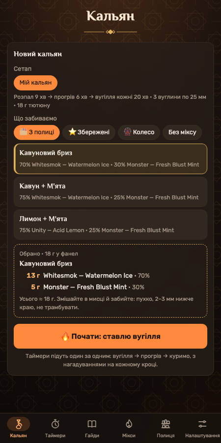
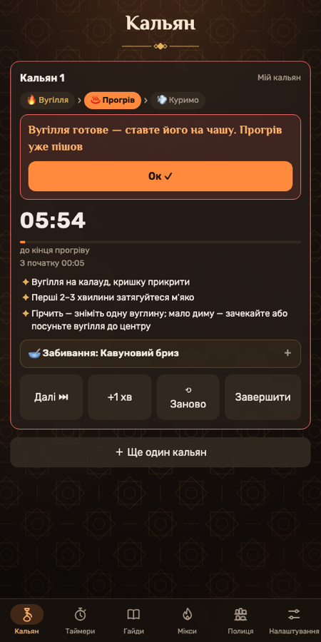
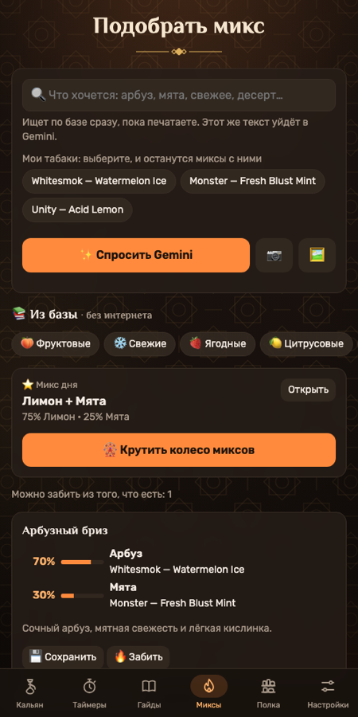
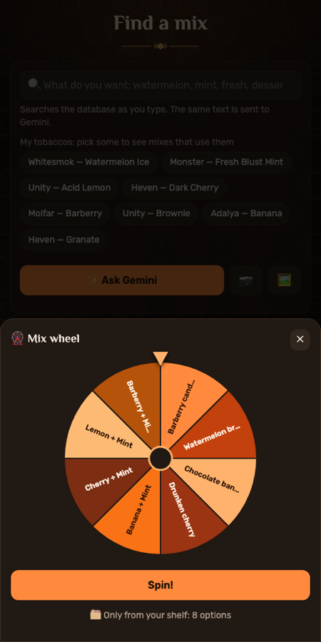

# 🔥 Кальянний помічник · Кальянный помощник · Hookah Helper

**[Українська](#-українська) · [Русский](#-русский) · [English](#-english)**

  
  
  
  

> 18+. Застосунок — довідник і таймер для тих, хто вже курить кальян. Він нічого не продає й не рекламує.
> 18+. Приложение — справочник и таймер для тех, кто уже курит кальян. Оно ничего не продаёт и не рекламирует.
> 18+. The app is a reference and timer for people who already smoke hookah. It doesn't sell or advertise anything.

---

## 🇺🇦 Українська

Застосунок для приготування кальяну: від вибору міксу до останньої вуглини.

**Що вміє**
- **Кальян крок за кроком.** Обираєте мікс — застосунок рахує грами під вашу чашу й запускає таймери один за одним: розпал → «переверніть вугілля» → «вугілля готове» → прогрів → нагадування повертати вугілля. В Android-версії сигнали ставляться як системні будильники й приходять навіть на заблокованому екрані.
- **Мікси без інтернету.** 65 класичних поєднань, пошук словами («свіже», «кавун м'ята», «десерт»), фільтри за профілем, мікс дня і колесо міксів — лише з того, що є на вашій полиці.
- **Полиця тютюнів.** Каталог ~2300 смаків 41 бренду, що продаються в Україні (за даними магазинів). Залишки в грамах списуються самі, а те, що закінчується, потрапляє у список покупок.
- **Gemini (за бажанням).** Сфотографуйте пачки — ШІ розпізнає смаки й запропонує мікси. Потрібен власний безкоштовний ключ з [aistudio.google.com](https://aistudio.google.com).
- **Мої чаші та вугілля**, гайди з забивання, довідка по брендах, резервна копія у файл.
- Три мови: українська, російська, англійська.

**Як встановити (Android)**
1. Відкрийте [Releases](../../releases/latest) і завантажте `kalyan-helper.apk`.
2. Відкрийте файл на телефоні → дозвольте встановлення з цього джерела → «Встановити».
3. Налаштування → «🔔 Дозволити сигнали» → увімкніть «Будильники та нагадування».
4. На Xiaomi / Samsung / Huawei вимкніть економію батареї для застосунку.

**Відгуки дуже потрібні!** Помилка, ідея, незграбний переклад, улюблений мікс, якого бракує, — пишіть у [Issues](../../issues/new/choose) або [Discussions](../../discussions). Кнопка «💬 Залишити відгук» є і в налаштуваннях застосунку.

---

## 🇷🇺 Русский

Приложение для приготовления кальяна: от выбора микса до последнего угля.

**Что умеет**
- **Кальян по шагам.** Выбираете микс — приложение считает граммы под вашу чашу и запускает таймеры друг за другом: розжиг → «переверните угли» → «угли готовы» → прогрев → напоминания поворачивать угли. В Android-версии сигналы ставятся как системные будильники и приходят даже на заблокированном экране.
- **Миксы без интернета.** 65 классических сочетаний, поиск словами («свежее», «арбуз мята», «десерт»), фильтры по профилю, микс дня и колесо миксов — только из того, что есть на вашей полке.
- **Полка табаков.** Каталог ~2300 вкусов 41 бренда, продающихся в Украине (по данным магазинов). Остатки в граммах списываются сами, а то, что заканчивается, попадает в список покупок.
- **Gemini (по желанию).** Сфотографируйте пачки — ИИ распознает вкусы и предложит миксы. Нужен свой бесплатный ключ с [aistudio.google.com](https://aistudio.google.com).
- **Мои чаши и угли**, гайды по забивке, справка по брендам, резервная копия в файл.
- Три языка: украинский, русский, английский.

**Как установить (Android)**
1. Откройте [Releases](../../releases/latest) и скачайте `kalyan-helper.apk`.
2. Откройте файл на телефоне → разрешите установку из этого источника → «Установить».
3. Настройки → «🔔 Разрешить сигналы» → включите «Будильники и напоминания».
4. На Xiaomi / Samsung / Huawei отключите экономию батареи для приложения.

**Очень нужны отзывы!** Ошибка, идея, кривой перевод, любимый микс, которого не хватает, — пишите в [Issues](../../issues/new/choose) или [Discussions](../../discussions). Кнопка «💬 Оставить отзыв» есть и в настройках приложения.

---

## 🇬🇧 English

An app for preparing hookah: from choosing a mix to the last coal.

**Features**
- **Step-by-step hookah.** Pick a mix — the app calculates grams for your bowl and runs timers one after another: lighting → "flip the coals" → "coals are ready" → heat-up → reminders to turn the coals. In the Android app, signals are scheduled as system alarms and arrive even on a locked screen.
- **Offline mixes.** 65 classic combinations, search by words ("fresh", "watermelon mint", "dessert"), profile filters, mix of the day and a mix wheel — using only what's on your shelf.
- **Tobacco shelf.** A catalog of ~2,300 flavors from 41 brands sold in Ukraine (from store listings). Stock in grams is deducted automatically, and whatever runs low goes to the shopping list.
- **Gemini (optional).** Take a photo of your packs — the AI recognizes flavors and suggests mixes. Requires your own free key from [aistudio.google.com](https://aistudio.google.com).
- **My bowls & coals**, packing guides, brand reference, backup to a file.
- Three languages: Ukrainian, Russian, English.

**Install (Android)**
1. Open [Releases](../../releases/latest) and download `kalyan-helper.apk`.
2. Open the file on your phone → allow installs from this source → "Install".
3. Settings → "🔔 Allow signals" → enable "Alarms & reminders".
4. On Xiaomi / Samsung / Huawei, turn off battery optimization for the app.

**Feedback wanted!** Bugs, ideas, awkward translations, a favorite mix that's missing — post in [Issues](../../issues/new/choose) or [Discussions](../../discussions). There's also a "💬 Leave feedback" button in the app settings.

---

## 🛠 Для розробників · Для разработчиков · For developers

| Папка | Що всередині |
|---|---|
| `hookah/` | Сам застосунок: один `index.html` без фреймворків, дані в `mixes.js`, `catalog.js`, `brands.js`, переклади в `i18n.js` |
| `android/` | Обгортка [Capacitor](https://capacitorjs.com) + точні будильники (`@capacitor/local-notifications`) |
| `tools/` | Переклади (`tr.tsv`) і скрипти, що збирають словник |
| `.github/workflows/android.yml` | Збирає підписаний APK і викладає його в Releases при кожному push у `main` |

Веб-версію можна відкрити локально: будь-який статичний сервер у папці `hookah/`.
Виправити переклад: змініть рядок у `tools/tr.tsv` і запустіть `python3 tools/build_i18n.py`.

**Звідки дані.** Каталог смаків і характеристики брендів зібрані з відкритих карток товарів магазинів [yolo.ski](https://yolo.ski) та [shisha-store.ua](https://shisha-store.ua) у жовтні 2026 року. Наявність змінюється.
**Приватність.** Застосунок нічого не збирає і нікуди не надсилає. Усі дані — на вашому телефоні. До Google йдуть лише ваші запити до Gemini, якщо ви самі додали ключ.

## Ліцензія · Лицензия · License

Код — [MIT](LICENSE). Шрифти [El Messiri](https://fonts.google.com/specimen/El+Messiri) і [Rubik](https://fonts.google.com/specimen/Rubik) — [SIL Open Font License 1.1](hookah/fonts/OFL.txt).
